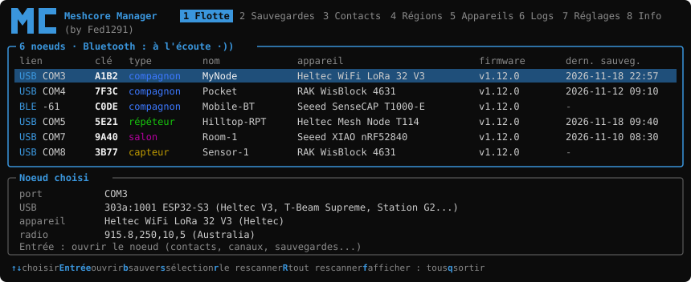
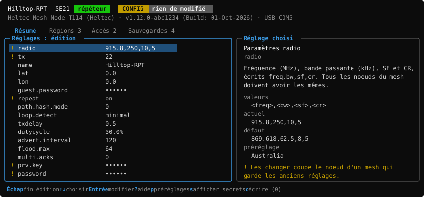
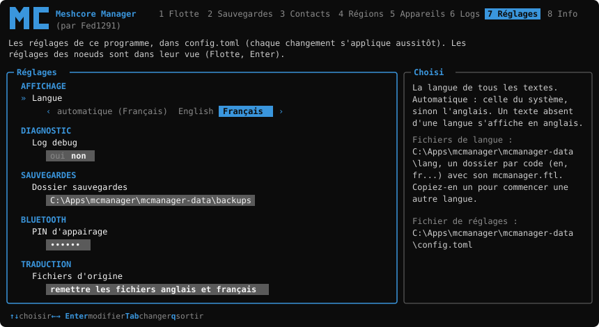

# Meshcore Manager

*[English version](README.md)*

Une appli en terminal pour vos noeuds [MeshCore](https://github.com/meshcore-dev/MeshCore) : les
voir tous (USB et Bluetooth), les sauvegarder, les restaurer, changer la plupart de leurs
réglages, un noeud ou tout un groupe d'un coup.

Je fais surtout ces outils pour moi, et je les partage tels quels, au cas où ils servent à
d'autres.

*Dessins des vrais écrans, avec des noeuds inventés.*

## Comment s'en servir
**[L'aide, avec des dessins](https://fed1291.github.io/meshcore-manager/)** (aussi `help.html`
dans chaque téléchargement), ou la même en texte, **[ici](meshcore-manager/README.fr.md)** :
- [Démarrer](meshcore-manager/README.fr.md#démarrer) : le lancer, brancher vos noeuds
- [Les pages](meshcore-manager/README.fr.md#pages) : à quoi sert chaque page
- [Sauvegarder](meshcore-manager/README.fr.md#sauvegarder) · [Restaurer](meshcore-manager/README.fr.md#restaurer) · [Restaurer sur une autre carte](meshcore-manager/README.fr.md#restaurer-sur-une-autre-carte)
- [Changer des réglages](meshcore-manager/README.fr.md#changer-des-réglages) · [Plusieurs noeuds d'un coup](meshcore-manager/README.fr.md#changer-plusieurs-noeuds-dun-coup)
- [Donner accès à un répéteur](meshcore-manager/README.fr.md#donner-accès-à-un-répéteur) · [Appairage Bluetooth](meshcore-manager/README.fr.md#appairage-bluetooth)
- [Toutes les touches](meshcore-manager/README.fr.md#touches) · [Fichiers](meshcore-manager/README.fr.md#fichiers)

## Télécharger
Prenez un programme prêt à l'emploi sur la page [Releases](../../releases). C'est un seul
fichier, rien à installer.

| Fichier | Pour |
|---|---|
| `mcmanager-<version>-windows-x64.zip` | Windows 10 / 11 (64 bits) |
| `mcmanager-<version>-linux-x86_64.tar.gz` | Linux sur PC (64 bits Intel / AMD), toute distribution |
| `mcmanager-<version>-linux-arm64.tar.gz` | Linux sur ARM 64 bits : Raspberry Pi 3 / 4 / 5 avec un système 64 bits, et autres cartes ARM, toute distribution |

Mac : pas de programme tout prêt et pas testé, mais vous pouvez essayer de le compiler ([BUILD.fr.md](BUILD.fr.md#3-macos-pas-testé)).

`SHA256SUMS.txt` (même page) permet de vérifier que le téléchargement n'est pas abîmé.

## Le compiler vous-même
Deux ou trois commandes : voir [BUILD.fr.md](BUILD.fr.md).

## Dans votre langue
Anglais et français intégrés. Une autre langue ne demande ni programmation ni nouveau programme,
juste des fichiers texte. La page Réglages montre où ils sont :

*`C:\Apps\mcmanager` est un exemple : le dossier où vous avez mis le programme. Son dossier
`mcmanager-data` est créé à côté.*

1. Lancez le programme une fois. À côté de lui, `mcmanager-data/lang/en/` contient les textes
   anglais : `mcmanager.ftl` (les écrans) et `settings_help.toml` (l'aide de chaque réglage).
2. Copiez le dossier `en` et nommez la copie avec le code de votre langue : `de`, `es`, `it`,
   `nl`, `pt-BR`...
3. Traduisez :
   - `mcmanager.ftl` : le texte après chaque `=`. Commencez par `language-name`, le nom de votre
     langue dans votre langue (`Deutsch`, `Español`).
   - `settings_help.toml` : les textes `title`, `summary`, `notes`, `warning` et `means`.
   - Laissez tels quels : les noms avant `=`, les parties `{ $quelquechose }`, et les autres
     champs.
4. Dans le programme, Réglages › Langue : votre langue est dans la liste. Ce qui n'est pas encore
   traduit s'affiche en anglais, vous pouvez donc avancer petit à petit.

N'importe quel éditeur de texte qui enregistre en UTF-8 convient : le Bloc-notes,
[Notepad++](https://notepad-plus-plus.org) ou [VS Code](https://code.visualstudio.com) (son
extension « Fluent » colore le fichier `.ftl`). Un traducteur comme DeepL ou une IA peut faire un
premier jet : vérifiez que les noms et les parties `{ $quelquechose }` sont revenus intacts.

## Licence
Fed1291

[CC BY-NC-SA 4.0](LICENSE). En bref, vous pouvez l'utiliser, le partager, le modifier et le
forker, à condition de :
- citer l'auteur ;
- ne pas en faire un usage commercial ;
- partager vos modifications sous la même licence.

MeshCore est sous licence MIT. L'aide des réglages dans l'appli est écrite à partir de son
firmware et de sa documentation.

Écrit avec l'aide de Claude (l'IA d'Anthropic).
