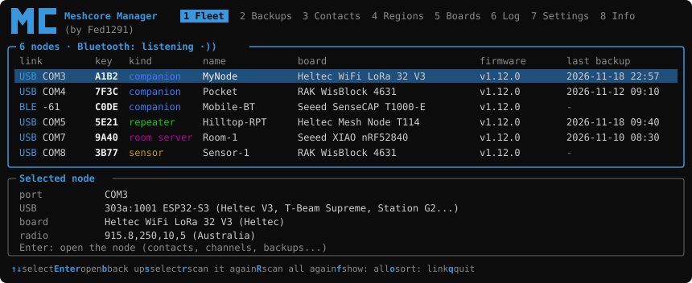
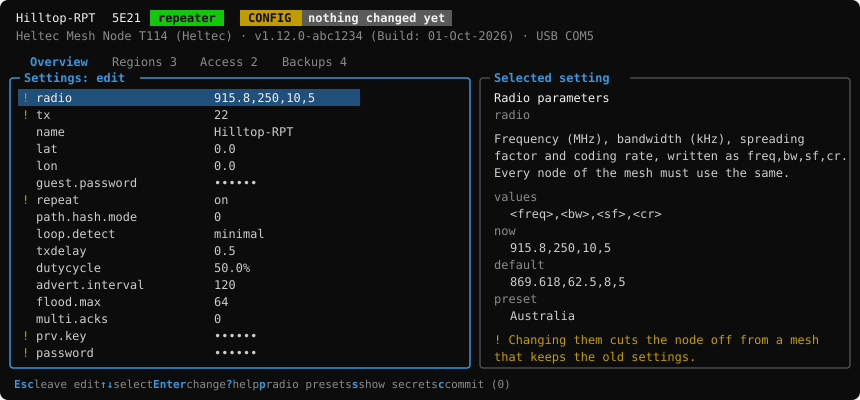
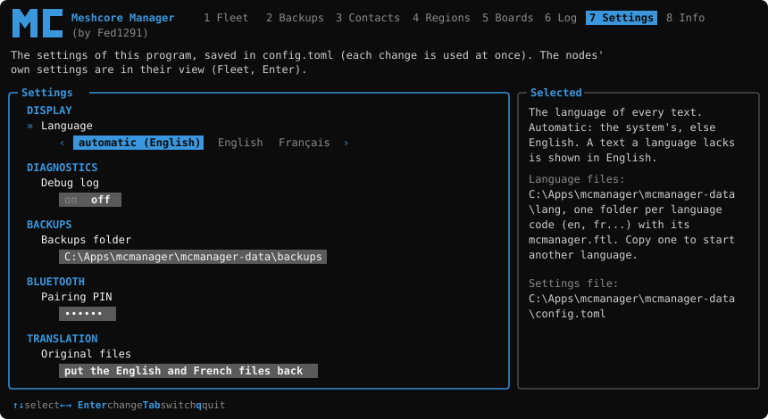

# Meshcore Manager

*[Version française](README.fr.md)*

A terminal app for your [MeshCore](https://github.com/meshcore-dev/MeshCore) nodes: see them all
(USB and Bluetooth), back them up, restore them, change most of their settings, one node or a
whole bunch at once.

I mostly make tools for myself, and share them as they are, in case they help someone else.

*Drawings of the real screens, with made-up nodes.*

## How to use it
**[The help, with pictures](https://fed1291.github.io/meshcore-manager/)** (also `help.html` in
each download), or the same as text, **[here](meshcore-manager/README.md)**:
- [Start](meshcore-manager/README.md#start): run it, plug in your nodes
- [The pages](meshcore-manager/README.md#pages): what each page is for
- [Back up](meshcore-manager/README.md#back-up) · [Restore](meshcore-manager/README.md#restore) · [Restore onto another board](meshcore-manager/README.md#restore-onto-another-board)
- [Change settings](meshcore-manager/README.md#change-settings) · [Several nodes at once](meshcore-manager/README.md#change-several-nodes-at-once)
- [Give access to a repeater](meshcore-manager/README.md#give-access-to-a-repeater) · [Bluetooth pairing](meshcore-manager/README.md#bluetooth-pairing)
- [All the keys](meshcore-manager/README.md#keys) · [Files it keeps](meshcore-manager/README.md#files)

## Download
Grab a ready-to-run program from the [Releases](../../releases) page. It's one file, nothing to
install.

| File | For |
|---|---|
| `mcmanager-<version>-windows-x64.zip` | Windows 10 / 11 (64-bit) |
| `mcmanager-<version>-linux-x86_64.tar.gz` | Linux on a PC (64-bit Intel / AMD), any distribution |
| `mcmanager-<version>-linux-arm64.tar.gz` | Linux on 64-bit ARM: Raspberry Pi 3 / 4 / 5 with a 64-bit system, and other ARM boards, any distribution |

Mac: no ready-made program and not tested, but you can try building it ([BUILD.md](BUILD.md#3-macos-not-tested)).

`SHA256SUMS.txt` (same page) lets you check that your download isn't damaged.

## Compile it yourself
A couple of commands: see [BUILD.md](BUILD.md).

## In your language
English and French are built in. Another language needs no programming and no new program, just
text files. The Settings page shows where they are:

*`C:\Apps\mcmanager` is an example: the folder where you put the program. Its `mcmanager-data`
folder is created next to it.*

1. Run the program once. Next to it, `mcmanager-data/lang/en/` holds the English texts:
   `mcmanager.ftl` (the screens) and `settings_help.toml` (the help on each setting).
2. Copy the `en` folder and name the copy with your language's code: `de`, `es`, `it`, `nl`,
   `pt-BR`...
3. Translate:
   - `mcmanager.ftl`: the text after each `=`. Start with `language-name`, your language's own
     name (`Deutsch`, `Español`).
   - `settings_help.toml`: the `title`, `summary`, `notes`, `warning` and `means` texts.
   - Leave as they are: the names before `=`, the `{ $something }` parts, and the other fields.
4. In the program, Settings › Language: your language is in the list. What isn't translated yet
   shows in English, so you can do it bit by bit.

Any text editor that saves UTF-8 works: Notepad, [Notepad++](https://notepad-plus-plus.org) or
[VS Code](https://code.visualstudio.com) (its "Fluent" extension colours the `.ftl` file). A
translator like DeepL or an AI can make a first draft: check that the names and `{ $something }`
parts came back untouched.

## License
Fed1291

[CC BY-NC-SA 4.0](LICENSE). In short, you can use, share, change and fork it, as long as you:
- give credit;
- don't use it commercially;
- share your changes under the same license.

MeshCore itself is under the MIT license. The settings help in the app is written from its
firmware and documentation.

Written with the help of Claude (Anthropic's AI).
